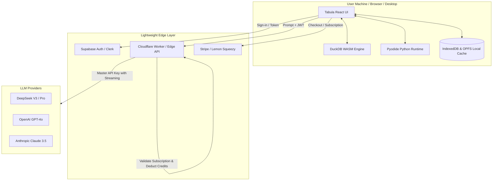

# Tabula — Commercial Product Blueprint & Monetization Strategy

## 1. Executive Summary & Value Proposition

**Tabula** is a private, local-first conversational data science and analytics workbench. Unlike cloud-dependent AI tools (like ChatGPT Code Interpreter or Julius AI) that require users to upload sensitive corporate data to third-party cloud servers, Tabula executes queries and Python scripts **entirely inside the user's browser** via **DuckDB WASM** and **Pyodide**.

### The Core Unfair Advantage
- **Zero Cloud Compute Costs for Analytics**: Query execution, aggregation, and Python code plotting run on client CPU/memory. You pay **$0** in compute infrastructure to run user calculations.
- **The "100% Data Privacy" Selling Point**: Financial institutions, healthcare companies, legal firms, HR departments, and accounting consultancies are strictly forbidden from uploading private spreadsheets to ChatGPT or cloud SaaS. Tabula is compliant by architecture: raw spreadsheet rows never leave the client's device.

---

## 2. Product Packaging & Target Personas

### Ideal Customer Profiles (ICPs)
1. **Financial Analysts & CFOs**: Modeling confidential P&L statements, burn rates, customer cohorts, and transaction registers.
2. **Healthcare & Clinical Researchers**: Analyzing patient callouts, trial registries, and HIPAA-sensitive medical metric sheets.
3. **Legal & Compliance Teams**: Reviewing sensitive discovery logs, billing audits, and contract tables.
4. **Data Journalists & Researchers**: Sifting through government data drops and whistleblower leaks with zero surveillance risk.
5. **Founders & Growth Marketers**: Analyzing Stripe export CSVs, churn metrics, and ad performance without paying for enterprise BI seats.

---

## 3. Tiered Monetization Model

| Tier | Price | Target | Features Included |
| :--- | :--- | :--- | :--- |
| **Community / Free** | $0 | Casual users, open-source adopters | • Bring Your Own API Key (BYOK) • In-browser DuckDB & Python • Local file export (CSV, PNG, MD) • Up to 25MB file sizes |
| **Tabula Pro** | **$19 / month** or **$190 / year** | Solopreneurs, financial analysts, growth leads | • **No API key needed** (Managed DeepSeek/OpenAI AI credits included) • Word & Docs ready table copying • Publication-ready Executive PDF export (custom branding) • Unlimited dataset size (GB+ with OPFS) • Studio Notes sync & export to Markdown/Jupyter • Priority model access |
| **Desktop Pro (Lifetime)** | **$129 one-time** | Privacy purists, offline-first professionals | • Native Windows & Mac app (Tauri/Rust wrapper) • 100% offline local LLM support (Ollama / LocalAI) • Zero network requests mode • 1 year of updates & priority support |
| **Team / Enterprise** | **$49 / user / mo** | Accounting, legal, & financial firms | • Central billing & seat management • Custom system prompts & company glossary • Encrypted cloud session sharing • SOC2 / HIPAA compliance sign-off guarantee |

---

## 4. System Architecture

---

## 5. Technical Implementation Roadmap

### Phase 1: Authentication & Database (Supabase)
1. Set up a Supabase project.
2. Run [`tabula.sql`](file:///b:/react/tabula/tabula.sql) in the Supabase SQL editor to provision the `profiles`, `subscriptions`, and `usage_ledger` tables with Row Level Security (RLS).
3. Connect `@supabase/supabase-js` into Tabula to handle user login, sign-up, and session tokens.

### Phase 2: Billing & Subscriptions (Stripe / Lemon Squeezy)
1. Set up Stripe Checkout or Lemon Squeezy (Lemon Squeezy is recommended if you don't want to handle international sales tax / VAT).
2. Create two products: `Monthly Pro ($19/mo)` and `Annual Pro ($190/yr)`.
3. Configure a webhook handler (e.g., Supabase Edge Function or Cloudflare Worker) that listens to:
   - `checkout.session.completed`
   - `customer.subscription.updated`
   - `customer.subscription.deleted`
4. Update the `subscriptions` table in Supabase accordingly.

### Phase 3: The Zero-Knowledge AI Proxy
*Users should never need to enter an OpenAI or DeepSeek API key.*
1. Create an Edge Function (Cloudflare Workers, Vercel Edge, or Supabase Edge Functions):
   - Receives: User JWT + conversation context.
   - Verifies: User is logged in and has an active Pro subscription or remaining free credits.
   - Injects: Your server-side master API key (`DEEPSEEK_API_KEY`).
   - Streams: SSE (Server-Sent Events) tokens back to the Tabula frontend.
   - Logs: Usage in `usage_ledger` for cost tracking.

### Phase 4: Desktop Packaging (Tauri)
1. Initialize Tauri in the project: `npm install -D @tauri-apps/cli`.
2. Configure Tauri to bundle the static build (`dist/`).
3. Compile lightweight (< 20MB) native `.exe` for Windows and `.dmg` for macOS.
4. Distribute via Gumroad, Lemon Squeezy, or your landing page.

---

## 6. Go-To-Market & Launch Playbook

1. **The "Show Don't Tell" Demo Video (30-45 seconds)**:
   - Screen record dragging a 100MB CSV into Tabula.
   - Disconnect Wi-Fi (proving offline/privacy).
   - Run SQL aggregation + Python distribution plot in under 2 seconds.
   - Tagline: *"Your company's financial data should never be trained on by public AI. Meet Tabula."*
2. **Launch Channels**:
   - **Hacker News (Show HN)**: Focus heavily on DuckDB WASM, local-first architecture, and client-side Python. HN loves privacy and local-first software.
   - **Product Hunt**: Launch on a Tuesday or Wednesday with clean demo GIFs.
   - **Twitter / X & LinkedIn**: Target CFOs, Excel power users, and financial modelers.
   - **Reddit**: r/dataisbeautiful, r/datascience, r/financialmodelling, r/excel.
