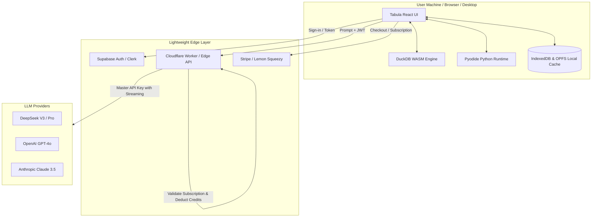

# Tabula — Commercial Product Blueprint & Monetization Strategy

## 1. Executive Summary & Value Proposition

**Tabula** is a private, local-first conversational data science and analytics workbench. Unlike cloud-dependent AI tools (like ChatGPT Code Interpreter or Julius AI) that require users to upload sensitive corporate data to third-party cloud servers, Tabula executes queries and Python scripts **entirely inside the user's browser** via **DuckDB WASM** and **Pyodide**.

### The Core Unfair Advantage

- **Zero Cloud Compute Costs for Analytics**: Query execution, aggregation, and Python code plotting run on client CPU/memory. You pay **$0** in compute infrastructure to run user calculations.
- **The "100% Data Privacy" Selling Point**: Financial institutions, healthcare companies, legal firms, HR departments, and accounting consultancies are strictly forbidden from uploading private spreadsheets to ChatGPT or cloud SaaS. Tabula is compliant by architecture: raw spreadsheet rows never leave the client's device.

---

## 2. Product Packaging & Target Personas

### Ideal Customer Profiles (ICPs)

1. **Financial Analysts & CFOs**: Modeling confidential P&L statements, burn rates, customer cohorts, and transaction registers.
2. **Healthcare & Clinical Researchers**: Analyzing patient callouts, trial registries, and HIPAA-sensitive medical metric sheets.
3. **Legal & Compliance Teams**: Reviewing sensitive discovery logs, billing audits, and contract tables.
4. **Data Journalists & Researchers**: Sifting through government data drops and whistleblower leaks with zero surveillance risk.
5. **Founders & Growth Marketers**: Analyzing Stripe export CSVs, churn metrics, and ad performance without paying for enterprise BI seats.

---

## 3. Tiered Monetization Model

| Tier                       | Price                                 | Target                                         | Features Included                                                                                                                                                                                                                                                                                   |
| :------------------------- | :------------------------------------ | :--------------------------------------------- | :-------------------------------------------------------------------------------------------------------------------------------------------------------------------------------------------------------------------------------------------------------------------------------------------------- |
| **Community / Free**       | $0                                    | Casual users, open-source adopters             | • Bring Your Own API Key (BYOK) • In-browser DuckDB & Python • Local file export (CSV, PNG, MD) • Up to 25MB file sizes                                                                                                                                                                    |
| **Tabula Pro**             | **$19 / month** or **$190 / year** | Solopreneurs, financial analysts, growth leads | • **No API key needed** (Managed DeepSeek/OpenAI AI credits included) • Word & Docs ready table copying • Publication-ready Executive PDF export (custom branding) • Unlimited dataset size (GB+ with OPFS) • Studio Notes sync & export to Markdown/Jupyter • Priority model access |
| **Desktop Pro (Lifetime)** | **$129 one-time**                     | Privacy purists, offline-first professionals   | • Native Windows & Mac app (Tauri/Rust wrapper) • 100% offline local LLM support (Ollama / LocalAI) • Zero network requests mode • 1 year of updates & priority support                                                                                                                    |
| **Team / Enterprise**      | **$49 / user / mo**                   | Accounting, legal, & financial firms           | • Central billing & seat management • Custom system prompts & company glossary • Encrypted cloud session sharing • SOC2 / HIPAA compliance sign-off guarantee                                                                                                                              |

---

## 4. System Architecture

---

## 5. Technical Implementation Roadmap

### Phase 1: Authentication & Database (Supabase)

1. Set up a Supabase project.
2. Run [`tabula.sql`](file:///b:/react/tabula/tabula.sql) in the Supabase SQL editor to provision the `profiles`, `subscriptions`, and `usage_ledger` tables with Row Level Security (RLS).
3. Connect `@supabase/supabase-js` into Tabula to handle user login, sign-up, and session tokens.

### Phase 2: Billing & Subscriptions (Stripe / Lemon Squeezy)

1. Set up Stripe Checkout or Lemon Squeezy (Lemon Squeezy is recommended if you don't want to handle international sales tax / VAT).
2. Create two products: `Monthly Pro ($19/mo)` and `Annual Pro ($190/yr)`.
3. Configure a webhook handler (e.g., Supabase Edge Function or Cloudflare Worker) that listens to:
   - `checkout.session.completed`
   - `customer.subscription.updated`
   - `customer.subscription.deleted`
4. Update the `subscriptions` table in Supabase accordingly.

### Phase 3: The Zero-Knowledge AI Proxy

_Users should never need to enter an OpenAI or DeepSeek API key._

1. Create an Edge Function (Cloudflare Workers, Vercel Edge, or Supabase Edge Functions):
   - Receives: User JWT + conversation context.
   - Verifies: User is logged in and has an active Pro subscription or remaining free credits.
   - Injects: Your server-side master API key (`DEEPSEEK_API_KEY`).
   - Streams: SSE (Server-Sent Events) tokens back to the Tabula frontend.
   - Logs: Usage in `usage_ledger` for cost tracking.

### Phase 4: Desktop Packaging (Tauri)

1. Initialize Tauri in the project: `npm install -D @tauri-apps/cli`.
2. Configure Tauri to bundle the static build (`dist/`).
3. Compile lightweight (< 20MB) native `.exe` for Windows and `.dmg` for macOS.
4. Distribute via Gumroad, Lemon Squeezy, or your landing page.

---

## 6. Go-To-Market & Launch Playbook

1. **The "Show Don't Tell" Demo Video (30-45 seconds)**:
   - Screen record dragging a 100MB CSV into Tabula.
   - Disconnect Wi-Fi (proving offline/privacy).
   - Run SQL aggregation + Python distribution plot in under 2 seconds.
   - Tagline: _"Your company's financial data should never be trained on by public AI. Meet Tabula."_
2. **Launch Channels**:
   - **Hacker News (Show HN)**: Focus heavily on DuckDB WASM, local-first architecture, and client-side Python. HN loves privacy and local-first software.
   - **Product Hunt**: Launch on a Tuesday or Wednesday with clean demo GIFs.
   - **Twitter / X & LinkedIn**: Target CFOs, Excel power users, and financial modelers.
   - **Reddit**: r/dataisbeautiful, r/datascience, r/financialmodelling, r/excel.

# Tabula — Virality & Launch Plan

## 1. Product Summary

Tabula is a local-first, conversational data-analysis workbench:

1. Drag in a CSV/XLSX file.
2. DuckDB-WASM + Pyodide analyze it entirely in the browser.
3. DeepSeek explains the data with tables, charts, and summaries.
4. Export to PDF, DOCX, HTML, CSV, PNG, or Jupyter notebook.

The core promise: **raw spreadsheet rows never leave the user's device.**

Current assets already in place:

- Landing page with privacy messaging, demo scenarios, pricing, FAQ (`src/features/landing/LandingPage.tsx`).
- Supabase auth, profiles, subscriptions, usage ledger (`tabula.sql`, `src/core/supabase/`).
- Sample dataset loader (`src/features/upload/UploadZone.tsx`).
- Export pipeline: PDF, DOCX, HTML, CSV, PNG, Jupyter (`src/core/export/`).
- PWA/service worker, production server proxy, CI (`server/index.mjs`, `public/sw.js`, `.github/workflows/ci.yml`).
- Monetization, ICPs, and a first-draft launch playbook (`idea.md`).

## 2. Decisions & Constraints

| Decision        | Choice                                            |
| :-------------- | :------------------------------------------------ |
| Target audience | Broad — anyone who wants to analyze their data    |
| GitHub repo     | Stays private (no open-source/community flywheel) |
| First milestone | Login → verification → then analyze               |
| Verified access | Required before analyzing the user's own files    |
| Growth model    | Organic, demo-led, with share/referral loops      |

### The core tension

A hard login + verification wall before any value kills virality. The fix is **demo-first, verify-to-unlock**:

- Let visitors run the sample dataset before signing up.
- Require email verification to upload/analyze their own files and to save/export.
- This keeps the "verify before you analyze" rule intact while giving people a reason to share.

## 3. Viral Strategy — The Three Loops

### Loop 1 — Export = Advertisement

Every chart PNG, PDF, DOCX, and shared link carries a subtle "Made with Tabula" badge + link back. Today only document exports carry branding (`src/core/export/exportFormats.ts`, `docxExport.ts`); chart PNGs do not.

### Loop 2 — One-Click Demo

Anyone can load a real, large sample and run a real analysis with no signup and no API key. The money shot:

> Drag CSV → unplug Wi-Fi → ask a question → get a chart → export.

Then gate saving/exporting behind verification.

### Loop 3 — Referral + Templates

- "Invite a colleague → 1 month Pro each."
- "Duplicate this analysis" template links.
- Public gallery of templates/analyses.

## 4. Milestone 1 — Verified Access Gate

### 4.1 Supabase configuration

- Auth → Email → enable **Confirm email** (verification required before a session is issued).
- Set **Site URL** + redirect URLs (`https://<domain>/#app`).
- Use a custom SMTP provider (Resend/Postmark) so verification emails do not hit spam.
- Optionally enable **bot protection** (Supabase Turnstile) on signup.
- Auth → URL configuration → allow the production domain and `localhost` for development.

### 4.2 App-level enforcement

- `src/features/auth/useAuth.ts`
  - Add `isVerified` derived from `user.email_confirmed_at`.
  - Add `needsVerification` to `AuthState`.
  - Keep exposing `user`, `tier`, `isPro`.
- `src/App.tsx`
  - Currently any session enters the app (lines 119–157).
  - New routing:
    - no user → landing/auth
    - user but unverified → `VerifyEmailScreen`
    - verified user → `AppShell`
  - Block workspace access until verified.

### 4.3 New Verify Email screen

Create `src/features/auth/VerifyEmailScreen.tsx`:

- "Check your inbox" message + the email address being verified.
- **Resend email** button with a 60-second cooldown (`supabase.auth.resend`).
- **I've verified — continue** button (`supabase.auth.refreshSession()` then re-check).
- **Use a different email** (sign out and restart).
- Support contact link.

### 4.4 Missing auth flows to add

- **Forgot password** — `supabase.auth.resetPasswordForEmail`. There is no reset link in `AuthScreen.tsx` today.
- **Social login** (Google/GitHub) via `supabase.auth.signInWithOAuth` — big conversion win for a broad audience.
- **Magic link** via `supabase.auth.signInWithOtp` — lowest-friction option.
- Handle email change → re-verify.
- Handle session expiry and bounced/complained emails gracefully.

### 4.5 Bot & abuse protection

- Turnstile or reCAPTCHA on signup.
- Honeypot field on the signup form.
- Rate-limit verification resends.
- Optional: block disposable email domains.
- Optional: registration allowlist / invite codes if abuse appears.

### 4.6 Demo-before-verify (viral path)

- Add **"Try the demo"** to `LandingPage.tsx`.
- It enters `AppShell` in a demo mode with the sample dataset loaded, no auth required.
- Gate uploads, exports, and saving behind verification.
- Goal: show the value in 30 seconds, then ask for an email.

### 4.7 Fix the sample credibility gap

`UploadZone.tsx` claims the sample is "1.2M rows · 84 MB", but `public/orders.csv` is **420 rows / 26 KB**.

Options:

1. Ship a real large sample (generate 1M+ rows, roughly 50–100 MB) — best for the demo and the speed claims.
2. Fix the copy to match the actual file.

The demo video and landing claims depend on this. A 420-row sample does not prove "millions of rows in 0.04s."

### 4.8 Funnel analytics

Add privacy-preserving analytics (Supabase events table or Plausible):

`landing → signup → verify → first analysis → export → share → referral signup`

Track:

- Landing conversion rate
- Signup completion rate
- Email verification rate
- Activation rate (first analysis)
- Share rate (shares per active user)
- Referral rate (signups per active user)
- Viral coefficient = shares per user × conversion from share

### 4.9 Tests

- Vitest: `isVerified` logic, unverified routing, resend cooldown.
- Playwright E2E: signup → pending → verified → workspace; unverified blocked; wrong-password path; password reset path.

## 5. Milestone 2 — Viral Loops

### 5.1 Watermark on chart exports

- Add a subtle "Made with Tabula" badge to chart PNGs in `src/core/utils/image.ts` and `src/features/render/Figure.tsx`.
- Keep it small enough not to ruin the chart, visible enough to drive clicks.

### 5.2 Share / public links

- Add a Share button on charts and reports.
- Generate a public URL (`/share/:id`) hosted via Supabase Storage.
- The share page must include:
  - OG title, description, and image (1200×630).
  - The chart/report preview.
  - A CTA: "Analyze your own data with Tabula."
- Do not expose raw user rows on the public page; share only the rendered result.

### 5.3 Referral program

- Unique referral code in Settings.
- Credit both sides (1 month Pro, or extended trial).
- Track invites, signups, and conversions in Supabase.

### 5.4 Export-to-social card

- Generate a 1200×630 PNG card for X/Twitter/LinkedIn with the chart, key finding, and watermark.
- One click → download → post.

### 5.5 Embeds and templates

- Embeddable chart iframes for blogs/Notion/internal wikis.
- "Duplicate this analysis" template links.
- A small public gallery of starter templates.

## 6. Milestone 3 — Launch Assets & Distribution

### 6.1 Demo video (the asset that carries the launch)

15–30 seconds, silent-friendly, captioned:

1. Drag a large CSV into Tabula.
2. Unplug the network cable / enable airplane mode.
3. Ask a question in plain English.
4. A chart and summary appear instantly.
5. Export to PDF/PNG.
6. Tagline: "Your files never leave your device. Meet Tabula."

### 6.2 GIFs and screenshots

- README hero GIF.
- Landing page demo GIF.
- Product Hunt gallery assets.
- X/Twitter/LinkedIn cards.

### 6.3 README overhaul

- Badges (build, license, live demo).
- Screenshot + demo GIF.
- "Try it now" link.
- Feature list in plain language (no jargon).
- Privacy guarantee section.

### 6.4 Social metadata

- Add Open Graph and Twitter Card tags to `index.html`.
- Create `public/og.png` (1200×630).
- Add canonical URL and JSON-LD structured data.
- Add `robots.txt` and `sitemap.xml` if doing SEO.

### 6.5 Distribution channels (broad audience)

- **Product Hunt** — Tuesday or Wednesday launch, GIFs + demo video.
- **Hacker News** — "Show HN" with the technical angle (DuckDB-WASM + Pyodide + local-first).
- **Reddit** — r/excel, r/datascience, r/LocalLLaMA, r/privacy, r/dataisbeautiful.
- **X/Twitter** — demo clips, privacy hot-takes, benchmarks, build-in-public.
- **LinkedIn** — analyst/CFO/consultant-facing posts.
- **TikTok/YouTube Shorts** — the offline demo.
- **Newsletters** — TLDR, Ben's Bites, local-first/analytics-focused lists.
- **Indie Hackers** — launch post + build-in-public updates.

### 6.6 Content / SEO

- Comparison pages: "Tabula vs ChatGPT", "Tabula vs Julius AI", "private Excel AI".
- Technical posts: "How we run DuckDB and Python entirely in the browser".
- Privacy posts: "Why your company's spreadsheets should not be pasted into ChatGPT".
- Keyword targets: "analyze CSV online free", "private Excel AI", "local-first data analysis", "ChatGPT data privacy alternative".

### 6.7 Hashtag strategy

- Product hashtag: `#DataNeverLeaves` or `#Tabula`.
- Founder signature: `#Inshall`.
- Campaign tag: `#OfflineAI` or `#PrivateAI`.

## 7. Quick Wins (do first, before anything else)

1. **OG tags + OG image** — 1 hour. Fixes dead social sharing.
2. **Watermark on chart PNGs** — 2 hours. Turns every export into an ad.
3. **"Try the demo" before signup** — 1 day. Removes the biggest conversion leak.
4. **Fix the sample claim / ship a real large sample** — 1 day. Makes the demo credible.
5. **Add password reset + social login** — 1 day. Removes avoidable drop-off.
6. **Verify Email screen + app enforcement** — 2 days. Delivers the first milestone.
7. **README + demo GIF** — 1 day. Makes the project look launch-ready.

## 8. Messaging Precision (avoid backlash)

The current claim is "zero files uploaded." Be precise:

> Your rows never leave your device. Only your question and a compact column summary are sent to the model.

This is defensible and still a powerful differentiator. Overclaiming invites trust problems and makes the demo video harder to defend.

## 9. Risks & Mitigations

| Risk                         | Mitigation                                                            |
| :--------------------------- | :-------------------------------------------------------------------- |
| Email verification drop-off  | Demo-first, social login, magic link, resend with clear UX            |
| Verification emails in spam  | Custom SMTP, branded template, SPF/DKIM/DMARC                         |
| Signup abuse / bot spam      | Turnstile, honeypot, rate limits, disposable-domain blocklist         |
| Large sample bandwidth cost  | Generate on the client from a small seed, or host a compressed sample |
| Viral claim vs. reality      | Show real benchmarks; never claim speeds the sample cannot prove      |
| Share links leaking raw data | Share rendered charts/reports only, never raw rows                    |

## 10. Confirmation Needed

1. **Demo-before-verify**: confirm this is acceptable, or require a fully closed gate.
2. **"Verification" definition**: email confirmation is assumed. If you mean stronger identity/payment verification, say so.
3. **Launch date**: is there a target date, or should the plan be sequenced without one?
4. **Budget**: organic only, or is there budget for ads/sponsored newsletters?
5. **Implementation order**: start with Milestone 1 (auth/verification) or the quick wins + viral loops?
